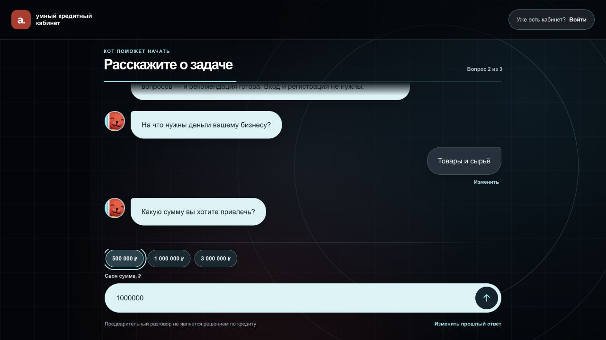

# Умный кредитный кабинет — frontend

React/Vite интерфейс для Go API кредитного конвейера. Контракт находится в
[`main` backend](https://github.com/Tilekbeki/smart-credit-backend/tree/main)
репозитория backend: `api/FRONTEND_INTEGRATION.md` и `api/openapi.yaml`.

## Запустить frontend, backend и scoring вместе

Нужны Docker Engine с Docker Compose v2, Git и доступ ко всем четырём репозиториям.
Общий репозиторий фиксирует совместимые версии модулей через Git submodules:

```sh
git clone --recurse-submodules https://github.com/Tilekbeki/smart-credit.git
cd smart-credit
docker compose up --build -d --wait --wait-timeout 300
```

Откройте [сайт](http://127.0.0.1:8081) или [кабинет](http://127.0.0.1:8081/cabinet).
Compose запускает React/Nginx, Go API с worker, Python scoring и PostgreSQL,
применяет миграции. Отдельный `.env` для локального запуска не требуется.

| Номер | Профиль | Роль |
| --- | --- | --- |
| `+79990000001` | ИП «Лавка у дома» | Клиент с подтверждёнными оборотами |
| `+79990000002` | ООО «Мастерская Север» | Клиент без счёта в Альфе, потребуется выписка |
| `+79990000003` | ООО «Точка вкуса» | Третий клиентский профиль |
| `+79990000004` | Мария Банкова | Сотрудник банка |

Код окружения — **`1221`**, реальные SMS не отправляются. Для смены профиля нажмите
«Выйти из кабинета»: после перезагрузки браузер восстанавливает последний вход.
Гостю доступен чат с рекомендацией без авторизации; новая заявка в кабинете
заполняется обычной формой, чат остаётся отдельным вариантом подбора.

Проверка связки и остановка из каталога `smart-credit`:

```sh
python3 scripts/smoke.py
docker compose ps --all
docker compose logs --tail=100 backend scoring
docker compose down
```

Smoke создаёт синтетические заявки и проверяет решения через реальную связку API
и scoring. `down` сохраняет базу и документы в volumes. Обновление, диагностика и
занятые порты описаны в [общем README](https://github.com/Tilekbeki/smart-credit#readme).

## Скриншоты

Реальные экраны локального стенда с синтетическими данными, 26 октября 2026.

### Главная


### Чат с котом



### Кабинет клиента


### Кабинет сотрудника


## Возможности и разработка

Сейчас работают полноэкранный гостевой чат и отдельная страница кабинета `/cabinet`, вход по тестовому
номеру и OTP, выбор продукта, предварительная
рекомендация, несколько приватных черновиков, загрузка документов, отправка заявки,
отслеживание проверок и финального решения. Для одобренной заявки показываются
полученные от backend сумма, срок, ставка и платёж; предложение можно принять
или отклонить. Ответ сохраняется в заявке и истории. Компании и данные синтетические.
Произвольный новый предприниматель пока не может зарегистрировать компанию через
этот API: доступны только синтетические профили. Данные о счёте пользователь может
необязательно указать в боковом меню: выбор хранится в этом браузере и используется
для подсказок. Требование выписки определяет backend, а не этот выбор. Принятие условий означает учебный статус `signed`,
но выдача средств в Go API не реализована.

### Подбор в чате

- Гость отвечает на вопросы о цели, сумме и сроке и получает рекомендацию типа
  продукта без регистрации. Это локальная подсказка по назначению кредита: API
  каталога и персонального подбора требует JWT, поэтому гостю не показываются
  вымышленные ставки, лимиты, платежи или одобрение.
- Вход через кнопку под рекомендацией открывает кабинет со списком заявок.
  Ответы доступны через «Продолжить подбор»: чат уточняет месячную выручку и расходы
  и вызывает `POST /recommendations`.
  Варианты корректировки суммы и срока также пересчитываются на backend.
- После проверки сводки клиент явно подтверждает отправку. Frontend создаёт один
  черновик и отправляет его через `/submit`. При запросе документов открывается
  этот же черновик в кабинете с подсказкой о нужном документе. Ошибка отправки
  не приводит к автоматическому созданию второй заявки.
- В кабинете доступны отдельные пункты «Подобрать в чате» и «Новая заявка».
  Последний сразу открывает обычную форму. Счёт в Альфе для подбора не требуется;
  сведения о счёте остаются необязательным полем кабинета. Самостоятельной
  регистрации через чат нет: вход использует существующие профили backend.

## Локальный запуск

Правила разработки и ревью для этого стека: [AGENTS.md](./AGENTS.md).
Общие DTO и валидация формы/чата находятся в `src/application-form.js`, чистая
логика кредитного пути — в `src/journey.js`, HTTP-контракт — в `src/api.js`.
Выделенные UI-компоненты находятся в `src/components/`, эффекты загрузки — в
`src/hooks/`, сценарии API и browser storage — в `src/services/`, справочники
и маршруты — в `src/config/`, общие форматтеры — в `src/utils/`.
Кабинет загружается при открытии `/cabinet`, модуль сотрудника — после входа с его
ролью. Публичные профили запрашиваются при открытии входа, а не гостевого чата;
повторная попытка загрузки не перезагружает страницу и не сбрасывает ответы.

Для просмотра всех сервисов вместе из общего репозитория `smart-credit` выполните
`docker compose up --build`. Откройте `http://127.0.0.1:8081/cabinet`.

Для отдельной разработки frontend:

1. Поднимите backend со scoring по инструкции
   [backend README](https://github.com/Tilekbeki/smart-credit-backend#readme),
   установив `DEMO_OTP_CODE=1221`. Дождитесь ответа `200` от
   `http://127.0.0.1:8080/ready`.
2. В этом репозитории выполните:

   ```sh
   npm ci
   npm run dev
   ```

3. Откройте адрес Vite из терминала. Кнопки на лендинге ведут в чат `/cabinet`;
   новая заявка заполняется в форме личного кабинета. Для проверки без SMS раскройте
   «Доступные профили для входа», выберите профиль и введите код.
   `/api` проксируется на Go backend по
   `http://127.0.0.1:8080`, поэтому настройка CORS не требуется.

Для входа по номеру возьмите тестовый номер из раскрывающегося блока, запросите код и введите
значение `DEMO_OTP_CODE`. Настоящее SMS не отправляется: backend пока принимает
только `profileId` и выдаёт тестовый OTP.
По требованию пользователя JWT хранится в `localStorage` до срока его действия
(8 часов в текущем backend). После обновления `/cabinet` frontend проверяет токен
через `/me`, загружает актуальные данные и открывает кабинет клиента или сотрудника.
Роль, companyId, OTP и финансовые сведения в хранилище сессии не сохраняются.
Выход и `401` очищают токен; истёкшая или повреждённая запись не восстанавливается.
При сетевом сбое восстановления доступна повторная загрузка без нового OTP.
Refresh-token и серверный logout API пока отсутствуют. Если browser storage недоступен,
вход работает в памяти текущей страницы.
Номер `+79990000004` открывает кабинет сотрудника с очередью отправленных заявок,
фильтрами статуса и компании, документами, сохранёнными рекомендациями Python,
факторами и отдельным результатом Go. Для ручного рассмотрения доступны внутренний
комментарий и публичное пояснение клиенту. Автообновление карточки приостанавливается
на время ввода решения.

Раздел «Контакты и данные» сохраняет дополнительный email пользователя и контакты
компании через отдельные PATCH с независимыми версиями. При конфликте ввод сохраняется
для сравнения. Финансовые сведения из профиля можно явно подставить в новую заявку.
Черновик можно удалить с подтверждением; при `draft_limit_reached` введённые данные
остаются на странице, пока пользователь освобождает место. Лимит по умолчанию — 20.
Проверено с backend `10da306` (миграция 12).

## Сценарий проверки интерфейса

1. На лендинге нажмите «Начать подбор». Пройдите три вопроса и проверьте, что
   рекомендация доступна без входа. «Войти в свой кабинет» откроет
   список заявок после OTP; «Продолжить подбор» вернёт к сохранённым ответам и запросит
   только недостающие финансовые данные. Для входа без подбора
   используйте «Уже есть кабинет? Войти». Введите номер профиля, запросите код
   и введите `1221`; настоящие SMS не отправляются.
2. Выберите цель «Товары и сырьё», проверьте сумму, срок и финансовые данные.
   Нажмите «Рассчитать варианты». В карточках видны
   предварительные причины подбора и доступность продукта.
3. Выберите подходящий продукт и сохраните черновик. Список готовности покажет
   сохранённые поля, известные требования к документам и следующий шаг.
4. Вернитесь в «Мои заявки» или выйдите и войдите снова: «Продолжить заявку»
   открывает тот же черновик. При необходимости приложите синтетический PDF,
   PNG или JPEG. Для инвестиционного кредита счёт на оборудование обязателен;
   выписку для оборотного кредита сервис может запросить при отправке.
5. Отправьте заявку и откройте её историю. Статус и этапы читаются из backend,
   оставшиеся черновики не меняются. После решения проверьте причины и условия
   предложения. Принятие или отклонение меняет статус заявки на `signed` или
   `closed`; повтор сетевого запроса использует тот же ключ идемпотентности.
   Выдача средств не имитируется.

Сравнение публичных банковских сценариев и приоритеты развития описаны в
[UX-бенчмарке](docs/UX_BENCHMARK.md) и [карте путей со счётом и без](docs/ACCOUNT_JOURNEYS.md).
Сторонние компоненты и смоделированные
интеграции перечислены в [THIRD_PARTY_NOTICES](THIRD_PARTY_NOTICES.md).

## Проверка

```sh
npm test
npm run build
```

[Отчёт сквозной проверки от 26.10.2026](docs/QA_REPORT_2026-10-26.md): все четыре
профиля, клиентские и банковские исходы, документы, конфликты, лимит черновиков,
разграничение доступа и технический сбой scoring. После исправлений проходят 50
модульных тестов. Границы выполненной проверки указаны в отчёте.

Интерфейс использует [Alfa Core DS](https://core-ds.github.io/core-components/master/?path=/docs/intro--docs).
Иллюстрация главного экрана предоставлена заказчиком. Pinterest-ссылка
использована как визуальный референс; сторонний ролик не копировался.
